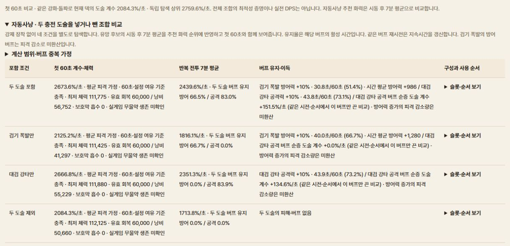

# 깨비 덱 연구실

사냥터나 가지고 있는 도술이 달라지면 지금 쓰는 조합의 강점도 달라집니다. 한 조합을 추천받고 끝내기보다, **조건을 바꿨을 때 왜 다른 조합이 나오는지** 보고 싶어 로컬 도구를 만들었습니다.

## 비교에 쓰는 값

캐릭터의 공격력과 체력, 자연회복, 실제로 본 피격량을 입력할 수 있게 했습니다. 사냥터의 적정 전투력은 사냥터를 고르는 참고값입니다. 피격량을 모르면 확인이 필요한 값으로 남기고, 입력한 조건에서 어떤 공격·회복·보호막이 계산에 들어갔는지 결과에서 볼 수 있게 했습니다.

## 영상에서 본 충전과 회복

11월 1일에 제가 플레이한 영상 두 건을 확인했습니다. 한 조건에서는 전투 중 자연회복이 5초 주기와 일치했고, 검기 폭발과 대검 강타는 충전 뒤에 쿨타임 숫자가 보였습니다. 두 도술은 풀차징해 사용한다는 조건을 제가 정했고, Codex는 충전 뒤부터 쿨타임을 세는 기준을 비교 도구에 반영했습니다.

_두 도술 포함, 각각 하나만 포함, 둘 다 제외를 따로 탐색한 화면입니다. 표의 수치는 같은 모델에서 계산한 값입니다._

## 실제로 확인한 범위

- **게임 영상**에서는 일부 회복·충전 동작을 관찰했습니다. 조건을 바꿔 같은 결과가 반복되는지는 별도 확인이 필요합니다.
- **로컬 모델**은 복사본에서 합성 입력으로 다시 검사했습니다. 충전 동작과 버프, 두 도술을 넣거나 뺀 네 조합 비교 등 **7개 검사**가 통과했습니다. 이 결과로 실제 게임 사냥의 피해량이나 물약 없이 생존할 수 있는지는 판단할 수 없습니다.

[다른 게임 도구와 검증 사례](../README.md) · [플레이 경험](../../play-experience/README.md)
