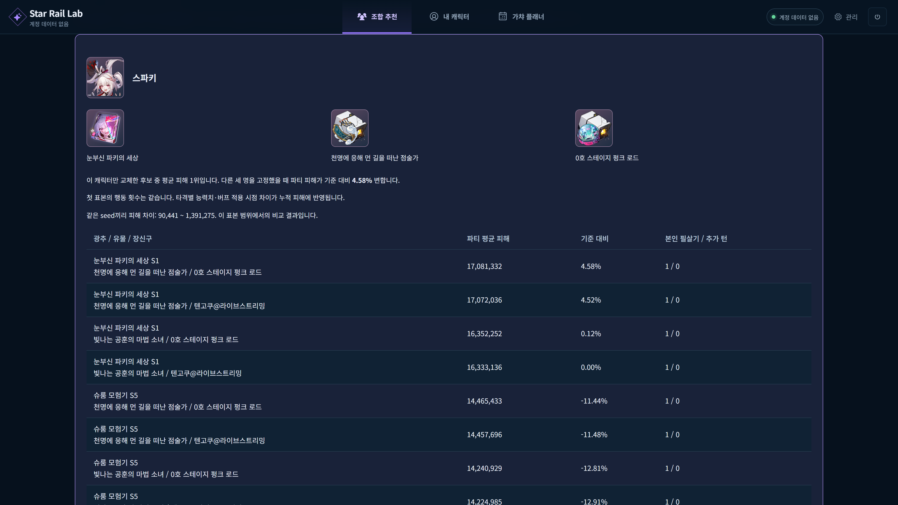

# Star Rail Lab

붕괴 스타레일을 하면서 이미 가진 캐릭터와 장비로 어떤 선택을 할 수 있는지 비교하고 싶었습니다. Star Rail Lab에서 제가 정한 목표는 조건을 바꿨을 때 그 조건에 맞는 새 결과를 볼 수 있게 하는 것이었습니다.

첫 결과에는 보유 장비와 콘텐츠 조건이 빠져 있었습니다. 어느 화면에서 기대와 다른 결과가 나오는지 보여 주고, 참고 자료와 로그를 붙여 필요한 입력을 다시 정했습니다. Codex는 화면과 계산 호출을 구현했습니다.

[조건을 바꾸면 이전 결과는 어떻게 될까](input-and-result-checks.md) · [코드와 실제 로컬 브라우저 검사](evidence/rotation-workbench.md) · [플레이 경험](../../play-experience/README.md)
