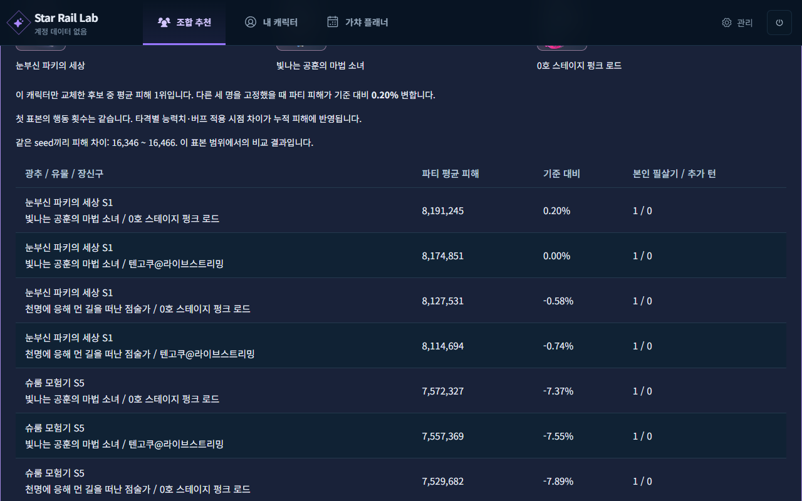

# Star Rail Lab 코드와 로컬 실행 기록

[React 코드 발췌](../code/rotation-input-excerpt.jsx)는 10월 20일 스냅샷에서 가져왔습니다. 제가 비교 목적과 필요한 입력을 정하고 결과를 살폈고, Codex는 구현을 맡았습니다. 발췌한 부분에는 이전 결과를 비우고 뒤늦게 도착한 요청을 구분하며 계산 자료의 식별값을 확인하는 처리가 있습니다. [발췌 출처와 범위](../code/source-manifest.json)

## 지원하는 네 명 파티로 확인한 실행

2026년 10월 20일의 별도 실행에서는 지원하는 파티에서 장비를 바꿀 후보를 비교했습니다. 브라우저가 실제 로컬 API에 요청을 보냈고 다섯 응답이 모두 정상으로 기록됐습니다. 화면에는 **장비 후보 32개와 이미지 16개**가 표시됐습니다. 당시 계산 로직 테스트 **32개**도 통과했습니다.

- **전투 길이를 변경했을 때** 먼저 화면에서 이전 결과가 사라지고 새 조건으로 계산되는지 확인했습니다.
- **지원하지 않는 파티로 바꿨을 때** 앞에서 계산한 결과를 보여 주지 않고 추천을 멈추는지 확인했습니다.



_당시 로컬 브라우저의 결과 화면입니다. 표의 수치는 고정한 조건의 모델 계산값입니다._

당시 브라우저 실행 원문에 남은 결과 요약입니다.

```json
{"actualAPI":true,"mocked":false,"candidates":32,"images":16,"durationMutation":true,"responses":[200,200,200,200,200],"errors":[]}
```

코드 발췌의 출처와 이 로컬 실행 기록은 각각 확인했습니다. 실행 결과가 보여 주는 범위는 이 파티와 입력 변경까지입니다. 실제 게임 피해량이나 모든 파티의 추천 성능을 판단하려면 별도 측정이 필요합니다.

[입력과 결과 사례](../input-and-result-checks.md) · [Star Rail Lab 소개](../README.md)
