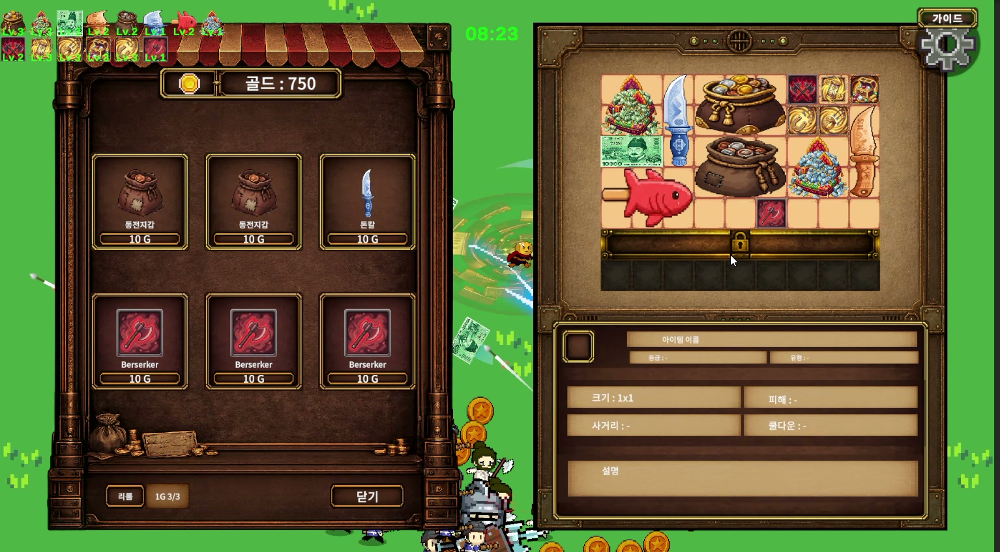

# Coin Survivor

**팀으로 제작해 STOVE와 Steam에 출시한 게임**

상점에서 아이템을 사서 가방에 넣거나 다시 파는 과정을 맡았습니다. 4~5월에 팀 제작에 참여했고 7월에는 공모전을 준비하면서 초반 전투와 상점 밸런스를 다시 봤습니다.

골드는 캐릭터 성장에 영향을 주면서 상점에서 무기와 패시브 아이템을 사는 데도 쓰입니다. 전투 사이에 가방부터 넓히느냐 아이템부터 사느냐에 따라 다음 웨이브가 달라집니다.

[STOVE 출시 페이지](https://store.onstove.com/ko/games/105249)와 [Steam 출시 페이지와 공식 플레이 영상](https://store.steampowered.com/app/5034980/Coin_Survivor/?l=koreana#game_highlights)

## 제가 맡은 일

- 초반에 가방을 늘린 뒤에도 아이템을 살 골드가 남는지 영상과 시트로 살폈습니다. [실제 상점 장면과 밸런스 시트](early-game-balance.md)
- 아이템을 집고 놓는 동작부터 손보기로 했습니다. Codex에 맡길 파일과 제가 직접 플레이해 볼 상황을 정했습니다. [아이템을 내려놓을 수 없을 때](inventory-pick-and-place.md)
- 판매한 무기만 전투에서 빠지는지 확인했습니다. ESC를 눌렀을 때 안내와 상점이 함께 닫히던 문제도 작업 기록에 남아 있습니다. [무기 판매 확인표](evidence/weapon-sale-play-mode.md)와 [ESC가 두 창에 전달된 문제](evidence/escape-key-priority.md)

Play Mode에서 확인한 동작과 밸런스 체감은 각각 작업하던 시점의 기록입니다.

[팀 회의에서 조작 안건을 보완한 과정](../../workflow/team-notes.md)

[포트폴리오 첫 화면](../../README.md)
