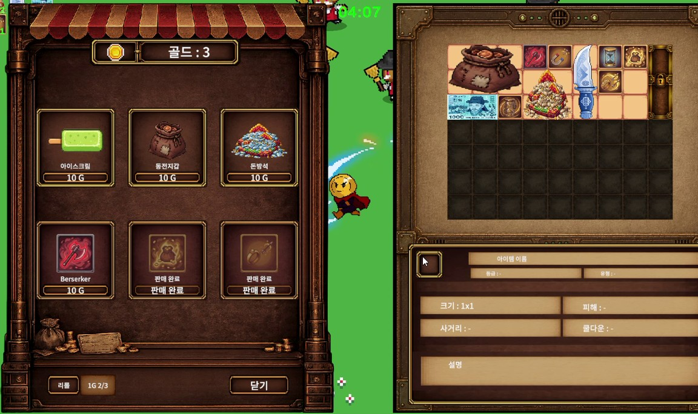

# 가방을 넓힌 뒤 아이템을 살 수 있을까

가방을 늘리고 나면 아이템을 살 골드가 부족했습니다. 화력이 모자라면 다음 웨이브에서 적을 놓치고, 그러면 다음 상점까지 모을 골드에도 영향이 생깁니다. 7월 공모전 준비 때는 **가방을 넓힌 플레이어에게 어떤 선택이 남는지**부터 살폈습니다.

## 같은 판에서 상점과 전투를 본 장면

**7월 16일 플레이 녹화, 재생 5:59.** 가진 골드는 3G이고 화면에 남은 아이템은 10G였습니다. 가방에 칸이 있어도 화면의 상품을 살 여유가 없는 순간입니다.

**같은 녹화, 재생 6:03.** 상점을 닫고 전투로 돌아온 직후에도 골드는 3G로 보입니다. 두 장면은 하나의 플레이에서 이어진 기록입니다. 비용 조정 효과는 별도 플레이에서 확인할 항목으로 뒀습니다.

## 상점 입장료와 가방 확장비

상점에 들어가는 비용을 없애는 안도 검토했습니다. 골드는 아이템을 사면서 쓰지만 체력과 성장에도 영향을 줍니다. 입장료를 한 번에 없애면 상점에 가는 횟수와 성장 속도까지 같이 달라질 수 있어, 초반 가방 확장을 가볍게 하고 확장을 거듭할수록 더 많은 비용을 내는 방향을 제안했습니다.

당시 작업 시트에는 두 안의 차이가 남아 있습니다.

- **v4 시트**의 인벤토리 경제에는 당시 기준인 첫 두 번의 확장비 **20G·40G**가 적혀 있습니다. 성장 곡선에는 상점 진입 비용을 없애는 안도 있었습니다.
- **v5 시트**는 첫 두 번의 확장비를 **5G·10G**로 두고 상점 입장료를 유지하는 안입니다. 상점에 들어간 뒤 남아야 할 생존 골드를 별도로 봤습니다. 이 수치는 시트의 설계값입니다.

플레이 영상을 돌아보면서 웨이브별 수급, 가방 확장과 아이템 구매에 쓴 돈, 이후 처치 상황을 같이 봤습니다. v5 시트의 경제 흐름 표에는 **실측 획득 골드와 상점 뒤 보유 골드**를 기록할 칸이 비어 있습니다. 실제 플레이에서 채워야 할 항목입니다.

## 다시 플레이한 뒤

제 플레이에선 조정 뒤 초반 성장이 덜 막혔습니다. 진화 무기의 공격 범위와 분열이 과한 부분을 줄이는 작업에도 참여했습니다. 기록에서 확인되는 결과는 당시 제 플레이에서 느낀 변화이며, 그 판에서 적용된 정확한 수치와 버전은 추가 확인이 필요합니다.

다시 비교한다면 같은 초반 조건에서 가방을 먼저 늘린 판과 아이템을 먼저 산 판을 각각 기록하고, 다음 웨이브의 처치와 구매 선택이 어떻게 달라졌는지 볼 생각입니다.

[Coin Survivor 소개와 공식 영상](README.md)
