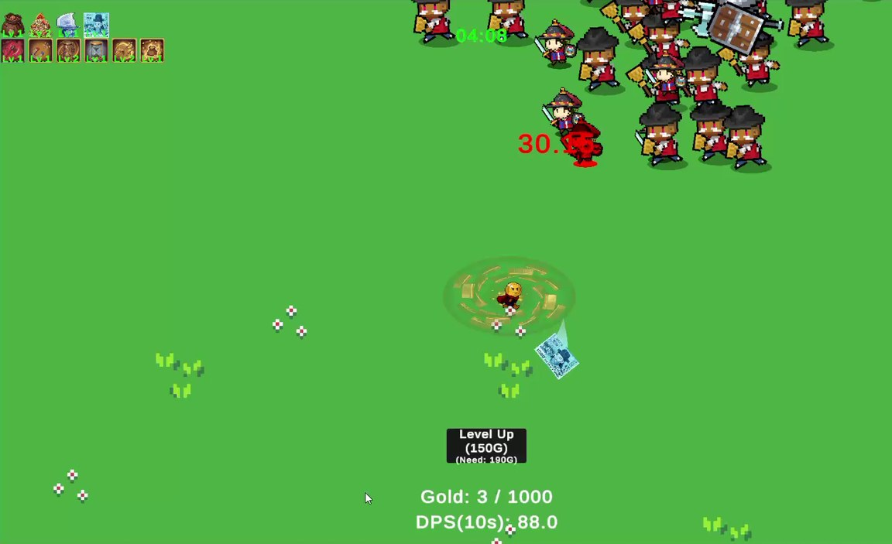

# 가방을 넓힌 뒤 아이템을 살 수 있을까

초반에 가방부터 넓히면 아이템을 살 골드가 부족했습니다. 무기가 약한 채로 다음 웨이브에 들어가면 적을 놓치기 쉽고 그만큼 다음 상점까지 모을 골드도 줄어듭니다. 7월 공모전 준비 때는 가방을 넓힌 뒤에도 **다음 전투를 준비할 여유가 남는지**부터 봤습니다.

## 같은 판에서 상점과 전투를 본 장면

**7월 16일 플레이 영상의 5분 59초.** 가진 골드는 3G이고 남아 있는 상품은 10G입니다. 가방에 빈칸이 있어도 살 수 없는 상황입니다.

**같은 영상의 6분 3초.** 상점을 닫고 전투로 돌아왔을 때도 골드는 3G였습니다. 이 영상에는 상점에서 살 수 있는 상품이 없었던 장면과 그 직후 전투가 이어집니다. 가격을 바꿨을 때의 효과는 같은 조건에서 다시 플레이해 봐야 알 수 있습니다.

## 상점 입장료와 가방 확장비

상점 입장료를 없애는 방법도 봤습니다. 골드는 체력과 성장에도 영향을 줍니다. 입장료부터 없애면 상점에 들르는 횟수나 성장 속도도 달라질 수 있었습니다. 그래서 상점 입장료를 두고 첫 몇 번의 가방 확장비를 낮추자는 안을 냈습니다. 가방을 여러 번 넓힐수록 더 많은 골드를 쓰게 하는 방식입니다.

- **v4 시트**에서 첫 확장비는 **20G**이고 두 번째는 **40G**입니다. 같은 시트의 성장 곡선에는 상점 입장료를 없애는 안도 있습니다.
- **v5 시트**의 제안은 첫 확장비를 **5G**로 두고 두 번째는 **10G**로 낮추는 것입니다. 상점 입장료를 유지하면서 전투 준비에 쓸 골드가 얼마나 남아야 할지도 따로 봤습니다.

플레이 영상을 돌려 보며 웨이브마다 번 골드를 가방을 넓히는 데 얼마나 쓰고 아이템에는 얼마나 썼는지 살폈습니다. 다음 전투에서 적을 얼마나 잡았는지도 함께 봤습니다. v5 시트에는 실제로 번 골드와 상점을 나온 뒤 남은 골드를 적는 칸이 비어 있습니다.

## 다시 플레이한 뒤

제가 다시 해 봤을 때는 초반 성장이 전보다 수월했습니다. 진화 무기의 공격 범위와 분열이 과한 부분을 줄이는 작업에도 참여했습니다. 당시 어떤 조정값을 적용한 빌드였는지는 기록으로 특정하기 어렵습니다.

한 번 더 비교한다면 같은 조건에서 가방부터 넓힌 판과 아이템부터 산 판을 기록하겠습니다. 다음 웨이브에 적을 얼마나 잡았는지와 그다음 상점에서 무엇을 살 수 있었는지를 나란히 보겠습니다.

[Coin Survivor 소개와 공식 영상](README.md)
