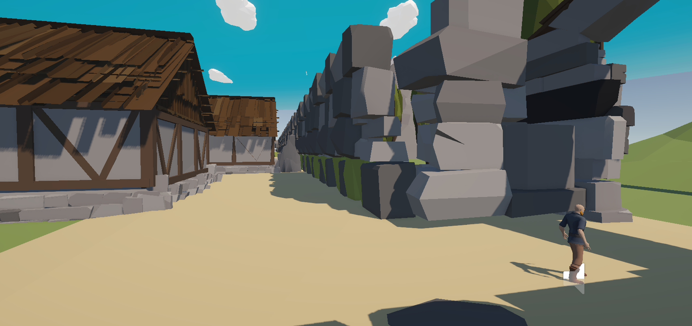

# EscapeRoom

**Unity 개인 제작 · 잠입 퍼즐**

마을을 돌아다니며 적의 시야를 피하고 퍼즐을 풉니다. 탐색 중 어디가 위험한지 알려 주는 것과, 실패한 뒤 다시 시도할 수 있는 흐름을 만들었습니다.

[적에게 들킨 뒤 체크포인트로 돌아오는 장면 · 5초](media/enemy-detection.gif) · [실패 후 플레이를 이어 가는 방법](failure-and-retry.md)

## 제가 고민한 부분

- 적이 근처에 있어도 바라보는 방향과 장애물에 따라 감지 결과가 달라져야 했습니다.
- 퍼즐을 풀던 중 실패하면 움직임을 잠시 막고 복구를 마친 뒤 조작을 돌려줘야 했습니다.
- 다시 시작할 위치와 이미 풀어 둔 퍼즐의 진행을 따로 다뤄야 같은 상황을 반복하지 않습니다.

2026년 3월의 시연 영상에서 탐색과 적 감지 장면을 볼 수 있습니다. 8월 24일에 별도 소스 복사본에서 실시한 Unity 자동 검사로는 시작 씬 초기화, 입력 잠금과 해제, 대표 퍼즐 실패 후의 상태 복귀를 확인했습니다.

[실패 처리 코드 발췌](code/failure-recovery.md) · [Play Mode 자동 검사 기록](evidence/play-mode-checks.md) · [포트폴리오 첫 화면](../../README.md)
