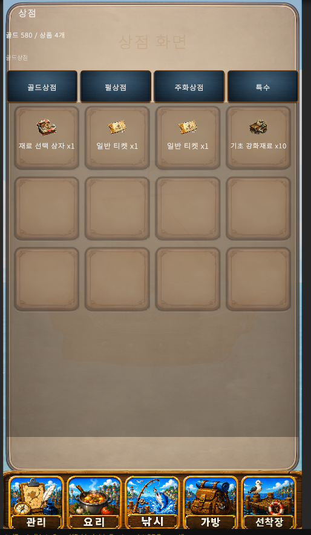

# Fisher Idle RPG

**팀으로 만든 방치형 RPG**

상점과 요리 화면을 비롯해 가방과 도감에서 버튼을 누르면 게임 데이터를 요청하고 돌아온 결과를 보여 주는 부분을 맡았습니다.

결과가 오기 전에 같은 버튼을 한 번 더 누르거나 다른 품목으로 넘어갈 수 있습니다. 화면에서 지금 선택한 품목과 게임에 이미 보낸 요청을 구분했습니다. 응답이 오면 그 결과를 화면에 반영했습니다.

| 화면에서 일어나는 일 | 처리하는 내용 |
| --- | --- |
| 품목을 선택함 | 선택한 품목과 버튼 상태를 표시 |
| 버튼을 누름 | 같은 요청을 연달아 보냈는지와 아직 끝나지 않은 요청이 있는지 확인 |
| 응답이 돌아옴 | 받은 값을 클라이언트에 반영하고 결과 문구를 표시 |

멀티플레이에서 돌아왔더니 없어야 할 가속권이 가방에 다시 보였습니다. 이 일을 계기로 팀과 함께 저장된 값과 화면에 보이는 값을 비교했습니다. [멀티플레이에서 돌아왔더니 가방이 달라졌다](bag-after-scene-change.md)

- [개당 가격과 총 판매가 안내를 바꾼 과정](sale-price-labels.md)
- [당시 확인한 값과 실행 범위](evidence/bag-state-checks.md)

[포트폴리오 첫 화면](../../README.md)
